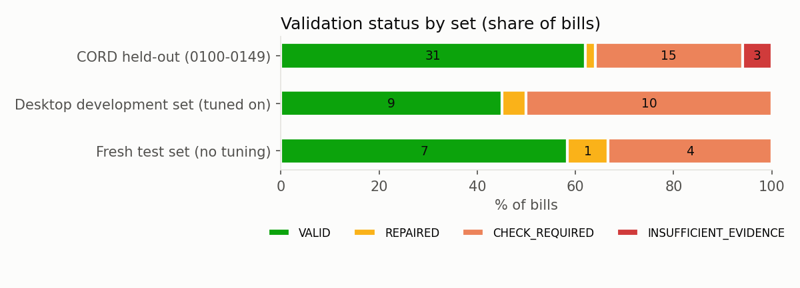
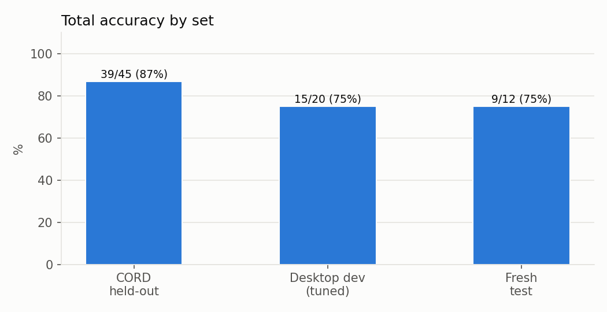
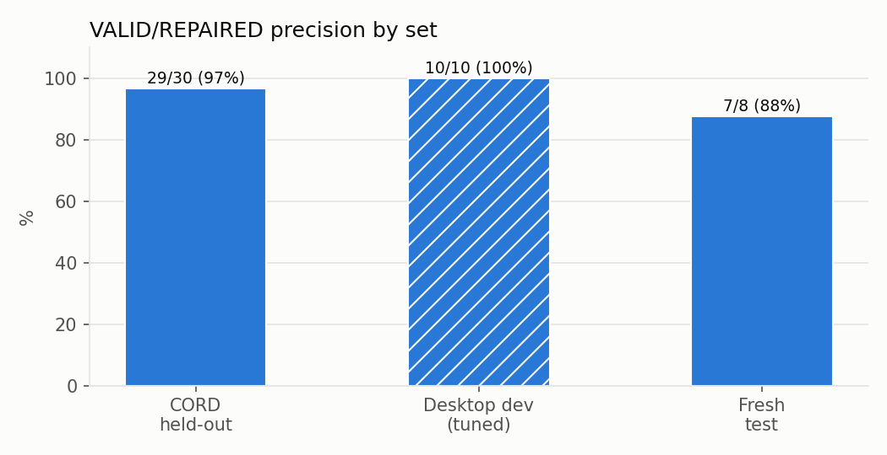
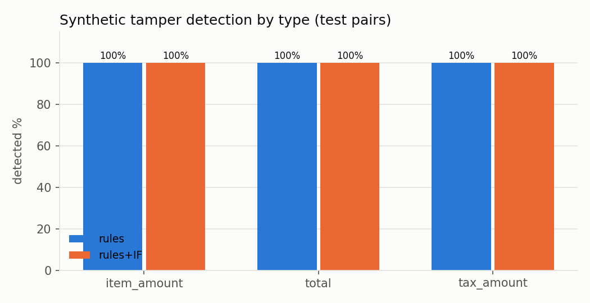
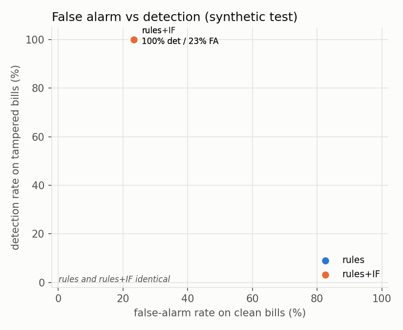

# CVAI results summary

All numbers are read from CSV files in outputs/eval/.

| Set | Bills | Total accuracy | VALID/REPAIRED precision | CHECK_REQUIRED with wrong total | Tamper detection | False alarm |
|---|---|---|---|---|---|---|
| CORD held-out (0100-0149) | 50 | 39/45 (87%) | 29/30 (97%) | 4/14 (29%) | - | - |
| Desktop development set (tuned on) | 20 | 15/20 (75%) | 10/10 (100%) | 5/10 (50%) | - | - |
| Fresh test set (no tuning) | 12 | 9/12 (75%) | 7/8 (88%) | 2/4 (50%) | - | - |
| Synthetic tamper test pairs, rules | 60 | - | - | - | 30/30 (100%) | 7/30 (23%) |
| Synthetic tamper test pairs, rules+IF | 60 | - | - | - | 30/30 (100%) | 7/30 (23%) |

## Synthetic tamper detection by type (test pairs)

| Tamper type | rules | rules+IF |
|---|---|---|
| item_amount | 10/10 (100%) | 10/10 (100%) |
| total | 10/10 (100%) | 10/10 (100%) |
| tax_amount | 10/10 (100%) | 10/10 (100%) |

## Status counts

| Set | VALID | REPAIRED | CHECK_REQUIRED | INSUFFICIENT_EVIDENCE |
|---|---|---|---|---|
| CORD held-out (0100-0149) | 31 | 1 | 15 | 3 |
| Desktop development set (tuned on) | 9 | 1 | 10 | 0 |
| Fresh test set (no tuning) | 7 | 1 | 4 | 0 |

## Figures

## Limitations

- OCR errors (misread digits, merged or split rows) remain the main source of wrong totals.
- A balanced forgery (item, tax and total all edited consistently) is not detected.
- Merchant extraction is weak (header text, logos and slogans are often picked instead).
- The synthetic tamper set is easier than real bills (clean renders, known layouts).
- Detection flags arithmetic inconsistency; it cannot separate tampering from OCR error.
